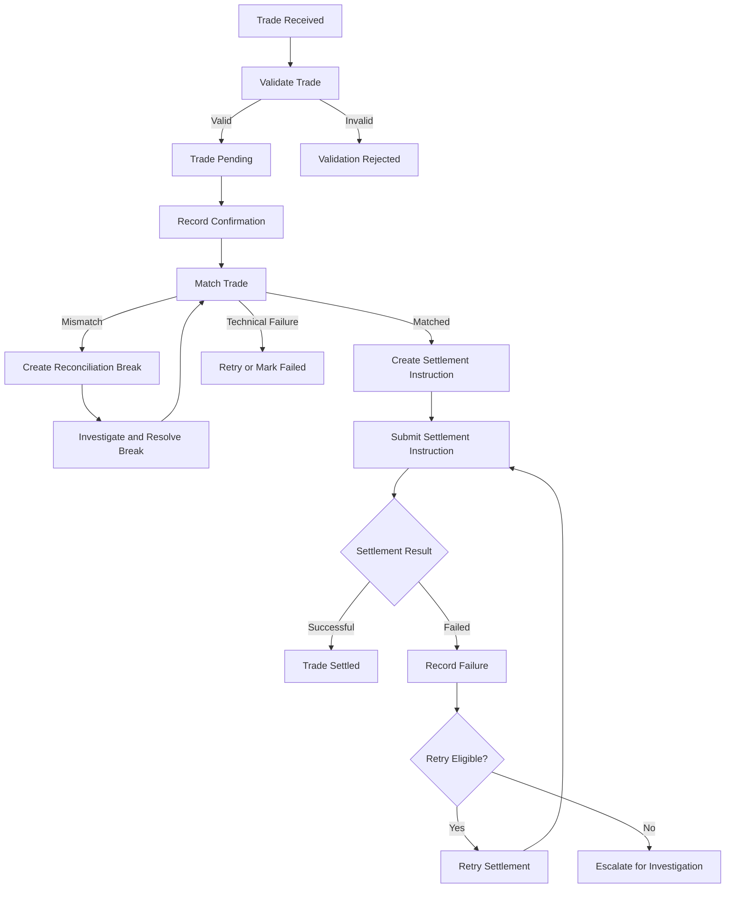
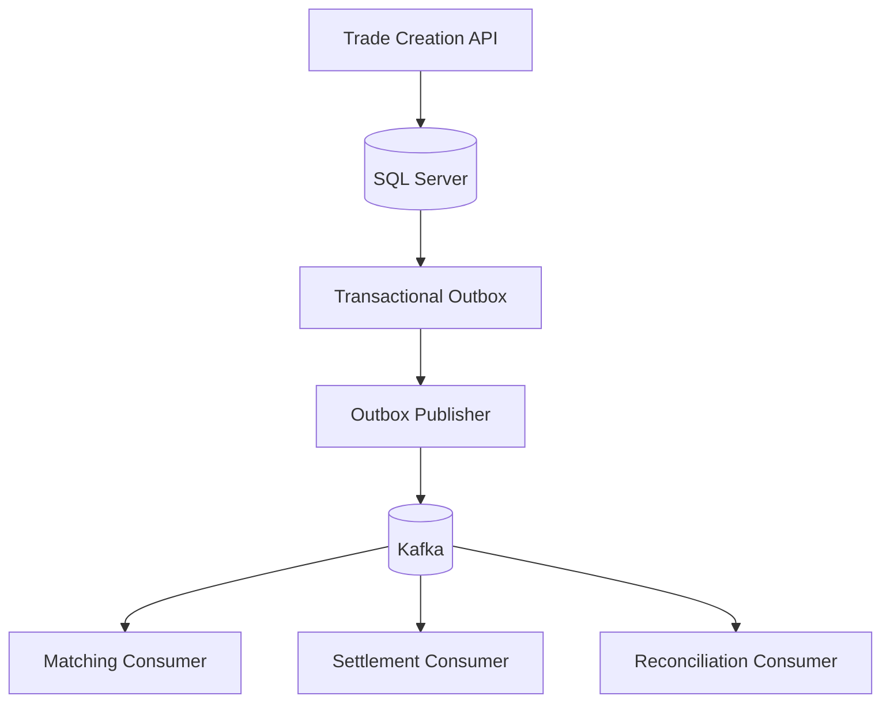

# SettleDesk — Trade Settlement & Reconciliation Platform

**A backend engineering project simulating financial trade processing, settlement, and reconciliation workflows.**

SettleDesk is an independent backend engineering project designed to simulate post-trade processing workflows commonly found in financial services.

The platform aims to manage the lifecycle of a financial trade, from trade capture and confirmation through matching, settlement instruction processing, and reconciliation.

It demonstrates how a backend system can maintain consistent trade state, process asynchronous events, handle failures, prevent duplicate operations, and maintain an auditable history of business transactions.

The planned technology stack includes Java, Spring Boot, Microsoft SQL Server, Apache Kafka, and Docker.


---

## Table of Contents

1. [Project Objectives](#1-project-objectives)
2. [Business Context](#2-business-context)
4. [End-to-End Trade Lifecycle](#4-end-to-end-trade-lifecycle)
5. [Trade and Settlement State Management](#5-trade-and-settlement-state-management)
6. [API Catalogue](#6-api-catalogue)
7. [Data Model](#7-data-model)
8. [Event-Driven Architecture with Kafka](#8-event-driven-architecture-with-kafka)
9. [Reliability and Failure Handling](#9-reliability-and-failure-handling)
10. [Security](#10-security)
11. [Technology Stack](#11-technology-stack)
12. [Project Structure](#12-project-structure)
13. [Local Development](#13-local-development)
14. [Testing Strategy](#14-testing-strategy)
15. [Docker and Deployment](#15-docker-and-deployment)
16. [Development Workflow](#16-development-workflow)
17. [Roadmap](#17-roadmap)
18. [Disclaimer](#18-disclaimer)

---

## 1. Project Objectives

The primary objectives are to:

- Build REST APIs for financial trade lifecycle management.
- Model trade confirmation, matching, settlement, and reconciliation.
- Enforce business rules through explicit state transitions.
- Process business events asynchronously using Apache Kafka.
- Maintain reliable persistence using Microsoft SQL Server.
- Prevent duplicate operations through idempotency.
- Identify, investigate, and manage reconciliation breaks.
- Maintain an auditable history of business operations.
- Handle transient failures through controlled retries and resilience patterns.
- Implement automated unit, integration, and API testing.
- Containerize the application and supporting infrastructure using Docker.
- Establish a CI/CD pipeline using GitHub Actions.
- Follow professional engineering practices through tickets, feature branches, code reviews, and pull requests.

## 2. Business Context

Financial trade processing involves more than recording a transaction.

After a trade is executed, relevant information must be captured, validated, confirmed with the counterparty, matched against corresponding records, and processed for settlement.

Settlement involves completing the obligations associated with a trade, such as the delivery of securities and the corresponding movement of funds. The exact workflow depends on the instrument, market, and settlement model.

Operational discrepancies may arise when records are missing, duplicated, or inconsistent between internal systems and external records.

SettleDesk will simulate these workflows using synthetic trade data and a simulated external settlement system.

The objective is to demonstrate the backend engineering challenges involved in:

- Processing trades reliably.
- Managing complex business state.
- Coordinating synchronous and asynchronous operations.
- Maintaining data consistency.
- Recovering from failures.
- Investigating reconciliation discrepancies.
- Providing operational visibility and auditability.

---


## 4. End-to-End Trade Lifecycle

The planned business workflow covers the following stages:

1. Trade capture.
2. Trade validation.
3. Trade confirmation.
4. Trade matching.
5. Settlement instruction creation.
6. Settlement processing.
7. Reconciliation.
8. Break investigation and resolution.
9. Audit and operational monitoring.

### Lifecycle Diagram



### Stage 1: Trade Capture

A client submits a trade through the trade creation API.

The application will:

1. Validate required fields and business constraints.
2. Check the idempotency key when provided or required.
3. Assign a unique trade identifier.
4. Persist the trade.
5. Record an audit event.
6. Make a trade-created event available for asynchronous processing.

The API will return the trade identifier and initial status.

### Stage 2: Trade Validation

Validation will include checks such as:

- Required trade attributes are present.
- Quantity and price satisfy defined constraints.
- Currency and instrument values are supported.
- Settlement dates satisfy configured business rules.
- Duplicate submissions are handled according to idempotency rules.

Invalid requests will return structured error responses.

### Stage 3: Trade Confirmation

Confirmation records represent responses received from a simulated counterparty or external source.

The system will retain confirmation details and associate them with the relevant trade.

Differences between the internal trade and confirmation will be available to the matching process.

### Stage 4: Trade Matching

The matching engine will compare the relevant attributes of corresponding records.

Potential matching fields include:

- Trade reference.
- Instrument identifier.
- Quantity.
- Price.
- Currency.
- Trade date.
- Settlement date.
- Counterparty.

Matching outcomes may include:

- Matched.
- Unmatched.
- Matched with discrepancies.
- Processing failure.

The exact matching rules will be defined during implementation.

### Stage 5: Settlement Instruction Creation

After the required checks succeed, the system will create a settlement instruction.

The instruction will contain the information needed by the simulated settlement processor.

A trade and its settlement instruction will have separate identifiers and status histories.

### Stage 6: Settlement Processing

The settlement processor will submit an instruction to the simulated external settlement system.

Possible outcomes include:

- Successful settlement.
- Business rejection.
- Temporary technical failure.
- Timeout or unknown outcome.

The application will record the result and update the instruction state according to defined business rules.

Retries will be restricted to eligible failures. Operations with uncertain outcomes will require appropriate safeguards against duplicate processing.

### Stage 7: Reconciliation

Reconciliation will compare internal records with simulated external records.

Examples of discrepancies include:

- An internal trade missing from external records.
- An external record missing internally.
- Quantity or price differences.
- Settlement-date mismatches.
- Duplicate records.
- A difference between expected and actual settlement status.

Discrepancies will be recorded as reconciliation breaks.

### Stage 8: Break Investigation and Resolution

A reconciliation break will contain information such as:

- Break identifier.
- Related trade or settlement.
- Break category.
- Expected and actual values, where applicable.
- Current status.
- Assignment information.
- Resolution reason.
- Creation and update timestamps.

Authorized users will be able to investigate and resolve breaks.

Resolution will be recorded in the audit history.

### Stage 9: Audit and Operational Visibility

Important operations will generate audit records.

The audit history will help explain:

- What changed.
- When it changed.
- Which operation caused the change.
- The previous and resulting states.
- Whether the operation succeeded or failed.

Operational endpoints will provide visibility into processing runs, settlement failures, reconciliation results, and application health.

---

## 5. Trade and Settlement State Management

Trade state and settlement state will be modelled separately.

### Trade Lifecycle

The initial proposed trade lifecycle is:

`RECEIVED → PENDING → MATCHED → SETTLED`

Additional states may include:

| State | Meaning |
|---|---|
| `RECEIVED` | Trade has been received by the application. |
| `PENDING` | Trade has passed initial validation and awaits further processing. |
| `MATCHED` | Required matching checks have succeeded. |
| `SETTLED` | Settlement has been confirmed according to the defined business rules. |
| `BROKEN` | A matching or reconciliation discrepancy requires investigation. |
| `FAILED` | Processing failed and requires recovery or intervention. |
| `REJECTED` | The trade was rejected by validation or a business rule. |
| `CANCELLED` | Cancellation was accepted under the applicable rules. |

The exact state model and permitted transitions will be finalized during domain modelling.

### Settlement Instruction Lifecycle

A proposed settlement lifecycle is:

`CREATED → SUBMITTED → SETTLED`

Additional states may include:

- `REJECTED`
- `FAILED`
- `PENDING_CONFIRMATION`
- `RETRY_PENDING`
- `CANCELLED`

The final statuses will distinguish business rejection, technical failure, and uncertain processing outcomes.

### State Transition Rules

The application will enforce valid transitions rather than allowing arbitrary status updates.

Examples:

- A trade cannot be marked as settled before the required processing succeeds.
- A settlement instruction cannot be submitted before its prerequisites pass.
- A completed settlement cannot be retried as though it had failed.
- A resolved reconciliation break must retain its resolution history.
- Invalid transitions must return a consistent error response.

Important state changes will be recorded for auditability.

---

## 6. API Catalogue

All endpoints below describe the intended API scope. They will be implemented and tested incrementally.

### 6.1 Health and Operational APIs

| Method | Endpoint | Purpose |
|---|---|---|
| GET | `/api/v1/health` | Basic application health. |
| GET | `/api/v1/ready` | Readiness for processing requests. |
| GET | `/api/v1/metrics/summary` | Retrieve selected business metrics. |
| GET | `/api/v1/processing/jobs` | List processing jobs. |
| GET | `/api/v1/processing/jobs/{jobId}` | Retrieve processing job details. |

### 6.2 Trade Management APIs

| Method | Endpoint | Purpose |
|---|---|---|
| POST | `/api/v1/trades` | Create a trade with idempotency protection. |
| GET | `/api/v1/trades` | Search trades with filters, sorting, and pagination. |
| GET | `/api/v1/trades/{tradeId}` | Retrieve a trade. |
| PUT | `/api/v1/trades/{tradeId}` | Update permitted trade attributes. |
| PATCH | `/api/v1/trades/{tradeId}/status` | Request a valid status transition. |
| POST | `/api/v1/trades/bulk` | Submit multiple trades. |
| POST | `/api/v1/trades/{tradeId}/cancel` | Request trade cancellation. |
| GET | `/api/v1/trades/{tradeId}/lifecycle` | Retrieve lifecycle history. |
| GET | `/api/v1/trades/{tradeId}/audit` | Retrieve trade audit history. |

### 6.3 Confirmation and Matching APIs

| Method | Endpoint | Purpose |
|---|---|---|
| POST | `/api/v1/trades/{tradeId}/confirmations` | Record a trade confirmation. |
| GET | `/api/v1/trades/{tradeId}/confirmations` | Retrieve trade confirmations. |
| POST | `/api/v1/matching/runs` | Start a matching run. |
| GET | `/api/v1/matching/runs` | List matching runs. |
| GET | `/api/v1/matching/runs/{runId}` | Retrieve matching-run status. |
| GET | `/api/v1/matching/runs/{runId}/results` | Retrieve matching results. |
| GET | `/api/v1/matching/exceptions` | Retrieve matching exceptions. |
| POST | `/api/v1/matching/runs/{runId}/retry` | Retry eligible matching failures. |

### 6.4 Settlement APIs

| Method | Endpoint | Purpose |
|---|---|---|
| POST | `/api/v1/settlements` | Create a settlement instruction. |
| GET | `/api/v1/settlements` | Search settlement instructions. |
| GET | `/api/v1/settlements/{settlementId}` | Retrieve settlement details. |
| POST | `/api/v1/settlements/{settlementId}/submit` | Submit an instruction. |
| POST | `/api/v1/settlements/{settlementId}/confirm` | Record settlement confirmation. |
| POST | `/api/v1/settlements/{settlementId}/retry` | Retry an eligible failure. |
| GET | `/api/v1/settlements/{settlementId}/status-history` | Retrieve status history. |
| GET | `/api/v1/settlements/{settlementId}/audit` | Retrieve settlement audit history. |

### 6.5 Reconciliation and Break Management APIs

| Method | Endpoint | Purpose |
|---|---|---|
| POST | `/api/v1/reconciliation/runs` | Start a reconciliation run. |
| GET | `/api/v1/reconciliation/runs` | List reconciliation runs. |
| GET | `/api/v1/reconciliation/runs/{runId}` | Retrieve reconciliation run details. |
| GET | `/api/v1/reconciliation/runs/{runId}/results` | Retrieve reconciliation results. |
| GET | `/api/v1/breaks` | Search reconciliation breaks. |
| GET | `/api/v1/breaks/{breakId}` | Retrieve break details. |
| PATCH | `/api/v1/breaks/{breakId}` | Update permitted break attributes. |
| POST | `/api/v1/breaks/{breakId}/resolve` | Resolve a break. |
| POST | `/api/v1/breaks/{breakId}/assign` | Assign a break. |
| GET | `/api/v1/breaks/summary` | Summarize breaks by category or status. |

### 6.6 Reference Data APIs

| Method | Endpoint | Purpose |
|---|---|---|
| GET | `/api/v1/instruments` | Search supported instruments. |
| GET | `/api/v1/instruments/{instrumentId}` | Retrieve instrument details. |
| GET | `/api/v1/counterparties` | Search counterparties. |
| GET | `/api/v1/counterparties/{counterpartyId}` | Retrieve counterparty details. |
| GET | `/api/v1/settlement-calendars` | Retrieve supported settlement calendars. |

### 6.7 Audit and Operation APIs

| Method | Endpoint | Purpose |
|---|---|---|
| GET | `/api/v1/audit-events` | Search audit events. |
| GET | `/api/v1/operations/{operationId}` | Retrieve a tracked operation's status. |

### API Design Principles

The APIs will follow these principles:

- Use appropriate HTTP methods and status codes.
- Validate incoming requests.
- Use consistent error response formats.
- Support pagination for potentially large result sets.
- Apply authorization to sensitive operations.
- Protect eligible write operations against duplicate requests.
- Avoid exposing internal implementation details.
- Keep business state transitions within application services rather than permitting arbitrary status updates.

---

## 7. Data Model

The planned domain model includes the following entities.

| Entity | Responsibility |
|---|---|
| `Trade` | Stores core trade information and current status. |
| `TradeConfirmation` | Stores confirmation records. |
| `SettlementInstruction` | Stores settlement instructions and outcomes. |
| `ReconciliationRun` | Tracks a reconciliation execution. |
| `ReconciliationResult` | Records the result for a compared record. |
| `ReconciliationBreak` | Tracks discrepancies requiring investigation. |
| `AuditEvent` | Records important business operations. |
| `IdempotencyRecord` | Tracks idempotent requests. |
| `OutboxEvent` | Stores events awaiting publication. |
| `ProcessingJob` | Tracks background processing operations. |
| `Instrument` | Stores supported instrument reference data. |
| `Counterparty` | Stores synthetic counterparty reference data. |

Relationships, keys, indexes, constraints, and transaction boundaries will be defined during database design.

### Important Data Design Considerations

- Use unique identifiers for trades, settlements, breaks, and processing runs.
- Store timestamps consistently.
- Preserve audit history for important business changes.
- Enforce uniqueness where duplicate business records are not permitted.
- Use database transactions for related changes that must succeed or fail together.
- Introduce concurrency controls where simultaneous requests could cause inconsistent state.

---

## 8. Event-Driven Architecture with Kafka

Apache Kafka will support asynchronous processing between application components.

### Planned Event Types

| Event | Purpose |
|---|---|
| `TradeCreated` | Indicates that a trade has been created. |
| `TradeConfirmed` | Indicates that a confirmation has been recorded. |
| `TradeMatched` | Indicates that matching succeeded. |
| `TradeMatchingFailed` | Indicates that matching failed. |
| `SettlementInstructionCreated` | Indicates that a settlement instruction is available. |
| `SettlementCompleted` | Indicates successful settlement. |
| `SettlementFailed` | Indicates settlement failure. |
| `ReconciliationCompleted` | Indicates completion of a reconciliation run. |
| `ReconciliationBreakDetected` | Indicates that a discrepancy was identified. |

Event names and payload schemas will be finalized during implementation.

### Example Event Flow



This is a conceptual architecture. Consumers and event flows will be introduced as the corresponding capabilities are implemented.

### Transactional Outbox Pattern

Publishing an event directly to Kafka after committing a database transaction can create a dual-write problem.

For example:

1. A trade is committed to SQL Server.
2. Publishing the corresponding Kafka event fails.
3. The database contains the trade, but downstream consumers are not notified.

The transactional outbox pattern will address this by writing the business change and an outbox record in the same database transaction.

A separate publisher will deliver committed outbox records to Kafka.

The publisher may deliver an event more than once, so consumers must be designed to handle duplicate delivery safely.

### Consumer Reliability

The planned Kafka consumers will consider:

- Idempotent event processing.
- Retry policies.
- Failed-message handling.
- Event ordering where required.
- Consumer offsets and recovery.
- Schema compatibility.
- Observability and processing metrics.

Kafka will be introduced when asynchronous workflows are ready, rather than being required for every API request.

---

## 9. Reliability and Failure Handling

Financial processing must account for failures at different points in a workflow.

### Idempotency

Selected write endpoints will accept an `Idempotency-Key` request header.

Repeated requests using the same key and equivalent payload should not create duplicate business operations.

Reusing a key with a different payload will be handled according to explicit validation rules.

Idempotency records will be persisted so the protection is not limited to a single application instance.

### Database Consistency

Database transactions will protect related changes that must succeed or fail together.

Concurrency controls will be introduced where simultaneous requests could otherwise produce inconsistent state.

### Retry Strategy

Retries will be restricted to operations and failures considered retryable.

The design will consider:

- Bounded retry attempts.
- Backoff between attempts.
- Idempotent processing.
- Duplicate event delivery.
- Timeouts and unknown outcomes.
- Escalation after repeated failures.

A timeout does not necessarily mean an external operation failed. The system must account for cases where the operation succeeded but its response was not received.

### Error Handling

The API will use consistent error responses, appropriate HTTP status codes, and request validation.

Sensitive information will not be exposed through error messages or logs.

### Auditability

Important business state transitions and operational actions will be recorded so processing outcomes can be investigated.

### Observability

The application will progressively introduce:

- Structured application logs.
- Health and readiness checks.
- Business processing metrics.
- Failure and retry metrics.
- Distributed tracing where appropriate.

---

## 10. Security

The planned security model will include:

- Authentication and authorization.
- Role-based access to operational actions.
- Validation of incoming requests.
- Secure handling of configuration and secrets.
- Restricted access to audit and operational information.
- Protection against unauthorized state transitions.

Security controls will be introduced as the corresponding application features are implemented.

Database credentials, access tokens, and other secrets must not be committed to the repository.

---

## 11. Technology Stack

The following describes the intended technology stack. Dependencies and infrastructure will be introduced incrementally.

### Backend

- Java 25
- Spring Boot 4.1.1
- Spring Web MVC
- Jakarta Bean Validation
- Spring Data JPA

### Database

- Microsoft SQL Server
- JDBC
- Transactional persistence

### Messaging

- Apache Kafka
- Event-driven architecture
- Transactional Outbox Pattern
- Asynchronous consumers

### Containerization and CI/CD

- Docker
- Docker Compose
- Git
- GitHub
- GitHub Actions

### Testing

- JUnit
- Spring Boot Test
- Unit tests
- Integration tests
- API tests

### Reliability and Observability

- Structured logging
- Health and readiness checks
- Metrics
- Resilience4j
- Distributed tracing

> The current application setup is API-first. Database, Kafka, Docker, and other supporting dependencies will be configured when their implementation phases begin.

---

## 12. Project Structure

The application will progressively adopt a layered structure.

```text
settledesk/
├── src/
│   ├── main/
│   │   ├── java/
│   │   │   └── com/
│   │   │       └── settledesk/
│   │   │           ├── controller/
│   │   │           ├── service/
│   │   │           ├── repository/
│   │   │           ├── model/
│   │   │           ├── dto/
│   │   │           ├── exception/
│   │   │           ├── config/
│   │   │           └── SettledeskApplication.java
│   │   └── resources/
│   │       └── application.properties
│   └── test/
│       └── java/
├── .github/
│   └── workflows/
├── .gitignore
├── Dockerfile
├── compose.yaml
├── pom.xml
├── mvnw
├── mvnw.cmd
└── README.md
```

This is the intended structure. Directories and files will be added when required; they do not all exist yet.

---

## 13. Local Development

### Prerequisites

- Java 25
- Maven Wrapper included in the repository
- IntelliJ IDEA or another Java IDE

Microsoft SQL Server and Kafka will be configured during their respective implementation phases.

### Run the Application

On macOS or Linux:

```bash
./mvnw spring-boot:run
```

On Windows:

```bash
mvnw.cmd spring-boot:run
```

The application uses port `8080` by default unless configured otherwise.

Database-dependent functionality will require the relevant database configuration.

### Configuration and Secrets

Environment-specific configuration will be managed separately from application code.

Credentials and other secrets must not be committed to Git.

Docker Compose will be introduced later to simplify local infrastructure setup.

---

## 14. Testing Strategy

Testing will be introduced throughout development rather than postponed until the end.

### Unit Tests

Test isolated business logic, including:

- Trade validation.
- State transition rules.
- Matching rules.
- Reconciliation calculations.
- Idempotency behavior.
- Retry eligibility.

### API Tests

Test:

- Successful requests.
- Invalid requests.
- Missing resources.
- Invalid state transitions.
- Error response formats.
- Filtering and pagination.
- Idempotency behavior.

### Integration Tests

Verify interactions between application components and infrastructure, including:

- Database persistence.
- Transaction boundaries.
- Kafka publication and consumption.
- Outbox processing.
- Duplicate event handling.
- Settlement failure and recovery.

### End-to-End Tests

Validate important workflows across multiple components.

An example is creating a trade, recording a confirmation, matching the trade, generating a settlement instruction, simulating settlement, and verifying the resulting state.

---

## 15. Docker and Deployment

Docker will package the application and provide a consistent runtime environment.

Docker Compose will coordinate the application and supporting infrastructure during local development.

### Planned Containerized Services

- SettleDesk Spring Boot application.
- Microsoft SQL Server.
- Apache Kafka.
- Any additional Kafka dependencies required by the selected configuration.

### Planned Docker Deliverables

- A Dockerfile for the Spring Boot application.
- A Compose configuration for local development.
- Environment-based configuration.
- Persistent storage where appropriate.
- Health checks and service dependencies.
- Documentation for starting and stopping the environment.

The exact Kafka deployment configuration will be selected when this phase begins.

### CI/CD

GitHub Actions will progressively automate:

- Build verification.
- Unit tests.
- Integration tests where configured.
- Pull request checks.
- Packaging of the application.

Container image publishing and deployment automation can be introduced later.

---

## 16. Development Workflow

SettleDesk will follow a ticket-driven development process.

1. Create a GitHub Issue describing the requirement.
2. Create a feature branch.
3. Implement the feature and automated tests.
4. Run the relevant checks locally.
5. Commit the changes.
6. Push the branch to GitHub.
7. Open a pull request.
8. Review the changes.
9. Merge the pull request into `main`.

Example branch names:

```text
docs/project-readme
feature/health-check-api
feature/trade-creation-api
feature/trade-state-machine
feature/kafka-event-publishing
feature/reconciliation-engine
```

Each ticket should have a clear objective, scope, acceptance criteria, and definition of done.

The README and architecture documentation will evolve as implementation decisions become concrete.

---

## 17. Roadmap

### Phase 1: Project Foundation

- [ ] Complete project documentation.
- [ ] Implement the health-check API.
- [ ] Establish layered application architecture.
- [ ] Configure Microsoft SQL Server.
- [ ] Define the initial trade domain model.
- [ ] Implement trade creation and retrieval APIs.
- [ ] Add request validation and exception handling.
- [ ] Establish automated test conventions.

### Phase 2: Trade Lifecycle

- [ ] Define and implement trade state transitions.
- [ ] Implement trade confirmation APIs.
- [ ] Implement idempotency.
- [ ] Add trade lifecycle history.
- [ ] Add audit history.
- [ ] Add appropriate transaction and concurrency controls.

### Phase 3: Matching and Reconciliation

- [ ] Implement the matching engine.
- [ ] Create reconciliation runs.
- [ ] Detect missing, duplicate, and mismatched records.
- [ ] Implement break management.
- [ ] Add break resolution and assignment.
- [ ] Implement settlement processing.
- [ ] Add controlled retry handling.

### Phase 4: Event-Driven Processing

- [ ] Introduce Apache Kafka.
- [ ] Publish trade lifecycle events.
- [ ] Implement asynchronous consumers.
- [ ] Implement the transactional outbox.
- [ ] Add retry and consumer error handling.
- [ ] Handle duplicate event delivery.
- [ ] Add event-processing observability.

### Phase 5: Security and Reliability

- [ ] Implement authentication and authorization.
- [ ] Strengthen concurrency controls.
- [ ] Introduce resilience patterns.
- [ ] Add health and readiness checks.
- [ ] Improve logs, metrics, and tracing.
- [ ] Expand automated test coverage.

### Phase 6: Containerization and CI/CD

- [ ] Create a Dockerfile.
- [ ] Configure Docker Compose.
- [ ] Run SQL Server in the local containerized environment.
- [ ] Run Kafka and its required components.
- [ ] Add infrastructure-backed integration tests.
- [ ] Set up GitHub Actions.
- [ ] Document local deployment and configuration.

---

## 18. Disclaimer

SettleDesk is an independent educational project intended to simulate financial trade processing concepts.

It is not connected to a production banking system, does not execute real financial transactions, and does not use confidential company code or data.